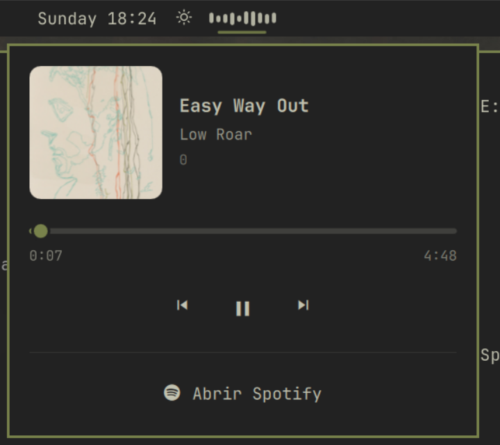

# Spotify Wave

Widget para la barra de [Omarchy](https://omarchy.org/) que muestra Spotify como una pequeña onda de reproducción. Al pasar el ratón por encima se abre una tarjeta con la canción y los controles.



## Características

- En la barra, solo una onda discreta que se mueve mientras suena la música y se queda quieta y atenuada en pausa
- Al pasar el ratón, una tarjeta con:
  - la portada del álbum, el título, el artista y el álbum
  - una barra de progreso con el tiempo transcurrido y el total, que puedes pulsar o arrastrar para saltar a otro punto
  - botones de anterior, reproducir/pausa y siguiente
  - un botón para abrir la ventana de Spotify
- Solo aparece mientras Spotify está abierto
- Muy ligero: la onda es una animación sencilla que no analiza el audio, y la información de la canción llega directamente de Spotify por MPRIS, sin scripts ni consultas periódicas
- Usa los colores de tu tema de Omarchy

## Instalación

```bash
omarchy plugin add https://github.com/Elipserus/SpotifyWave --enable
```

Se coloca en la zona central de la barra. Para moverlo, por ejemplo justo detrás del tiempo:

```bash
omarchy bar move io.github.elipserus.spotify-wave --after omarchy.weather
```

## Desinstalación

```bash
omarchy plugin remove io.github.elipserus.spotify-wave
```

## Uso

Pasa el ratón por la onda para abrir la tarjeta y controla Spotify desde ahí. La tarjeta se cierra sola al apartar el ratón.

### Atajos de teclado y scripts

El widget expone un destino IPC, así que puedes asignar estas órdenes a teclas en `~/.config/hypr/bindings.lua`:

```bash
omarchy-shell io.github.elipserus.spotify-wave playPause   # reproducir/pausa
omarchy-shell io.github.elipserus.spotify-wave next        # siguiente
omarchy-shell io.github.elipserus.spotify-wave previous    # anterior
omarchy-shell io.github.elipserus.spotify-wave card        # abrir o cerrar la tarjeta
```

## Cómo funciona

Spotify publica su estado por MPRIS, la interfaz multimedia estándar de Linux. El widget usa el soporte de MPRIS de Quickshell para leer la canción, la portada y el progreso, y para enviar las órdenes de reproducción.

## Requisitos

- Omarchy con el shell basado en Quickshell
- Spotify

## Créditos

Spotify es una marca de Spotify AB; este proyecto no está afiliado a Spotify.

## Licencia

MIT
